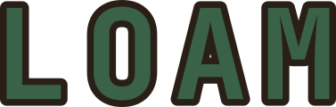
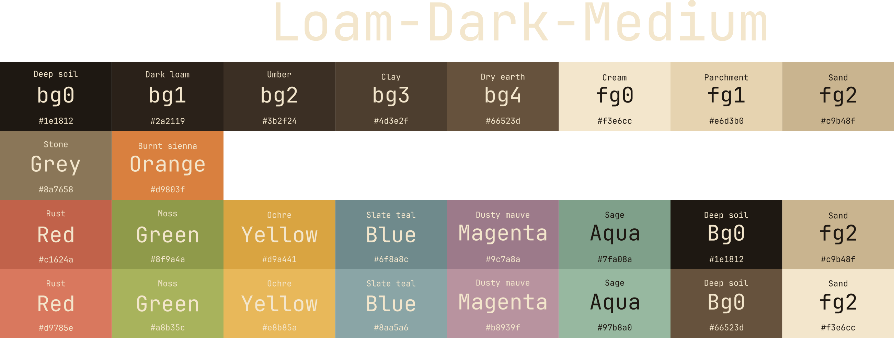
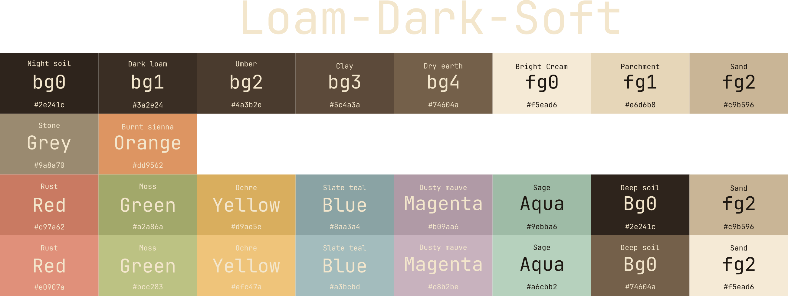
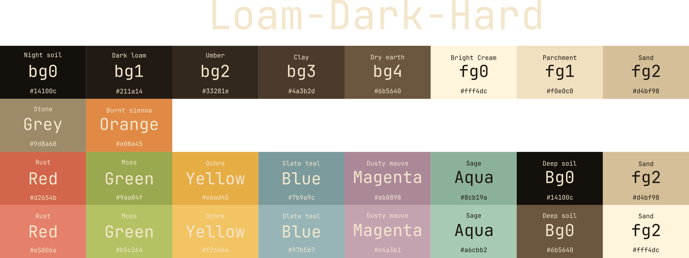
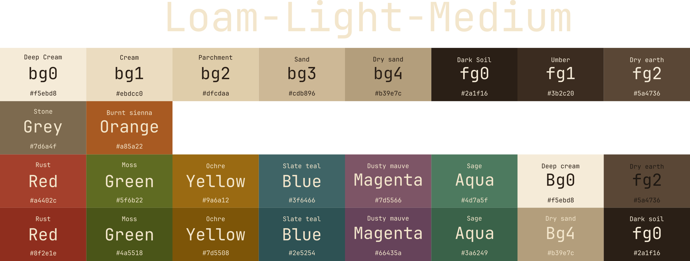
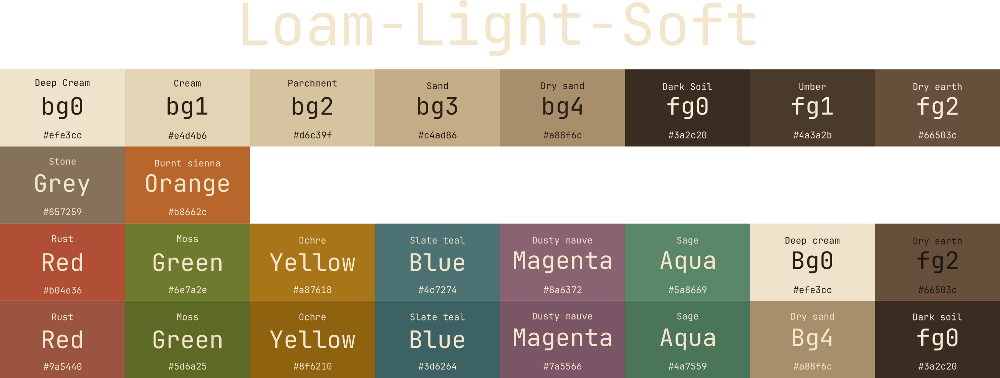
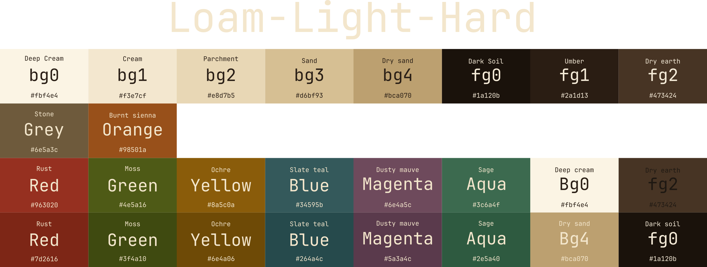

# Loam Theme

Loam is a warm, earth-toned color scheme in six variants: **Dark** and **Light** modes, each with **Default (Medium)**, **Soft** (low contrast), and **Hard** (high contrast). Each variant has a base palette and a bright palette. The base palette is the main set of colors, and the bright palette is a lifted version for emphasis and readability. The scheme is inspired by Gruvbox, and its brown backgrounds and warm accents are meant to reduce blue light.

## Variants at a Glance

| Variant | Mode | Contrast | Best for |
|---|---|---|---|
| Loam Dark Medium | Dark | Medium | Everyday coding with balanced contrast |
| Loam Dark Soft | Dark | Low | Long sessions where glare or eye strain is a concern |
| Loam Dark Hard | Dark | High | Maximum text clarity and sharp separation between panels |
| Loam Light Medium | Light | Medium | Bright rooms and daytime use |
| Loam Light Soft | Light | Low | Gentle, low-glare daytime reading |
| Loam Light Hard | Light | High | Crisp, high-readability text on light backgrounds |

## Palettes

Each table lists the background and foreground roles, followed by the accent colors in their base and bright versions. A dash means the role has no bright variant.

### Dark Mode

#### Loam Dark Medium

| Role | Base | Bright |
|---|---|---|
| Bg0 | `#1e1812` | — |
| Bg1 | `#2a2119` | — |
| Bg2 | `#3b2f24` | — |
| Bg3 | `#4d3e2f` | — |
| Bg4 | `#66523d` | — |
| Fg0 | `#f3e6cc` | — |
| Fg1 | `#e6d3b0` | — |
| Fg2 | `#c9b48f` | — |
| Gray | `#8a7658` | `#a89476` |
| Red | `#c1624a` | `#d9826a` |
| Green | `#8f9a4a` | `#b2b872` |
| Yellow | `#d9a441` | `#e8b866` |
| Blue | `#6f8a8c` | `#92b0b2` |
| Purple | `#9c7a8a` | `#bca4b0` |
| Aqua | `#7fa08a` | `#a8c4ac` |
| Orange | `#d9803f` | `#e8a06a` |

#### Loam Dark Soft

| Role | Base | Bright |
|---|---|---|
| Bg0 | `#2e241c` | — |
| Bg1 | `#3a2e24` | — |
| Bg2 | `#4a3b2e` | — |
| Bg3 | `#5c4a3a` | — |
| Bg4 | `#74604a` | — |
| Fg0 | `#f5ead6` | — |
| Fg1 | `#e6d6b8` | — |
| Fg2 | `#c9b596` | — |
| Gray | `#9a8a70` | `#b3a388` |
| Red | `#c97a62` | `#e0907a` |
| Green | `#a2a86a` | `#bcc283` |
| Yellow | `#d9ae5e` | `#efc47a` |
| Blue | `#8aa3a4` | `#a3bcbd` |
| Purple | `#b09aa6` | `#c8b2be` |
| Aqua | `#9ebba6` | `#b6d1bd` |
| Orange | `#dd9562` | `#f0aa7a` |

#### Loam Dark Hard

| Role | Base | Bright |
|---|---|---|
| Bg0 | `#14100c` | — |
| Bg1 | `#211a14` | — |
| Bg2 | `#33281e` | — |
| Bg3 | `#4a3b2d` | — |
| Bg4 | `#6b5640` | — |
| Fg0 | `#fff4dc` | — |
| Fg1 | `#f0e0c0` | — |
| Fg2 | `#d4bf98` | — |
| Gray | `#9d8a68` | `#6b5640` |
| Red | `#d2654b` | `#e5806a` |
| Green | `#9aa84f` | `#b5c264` |
| Yellow | `#e6ad45` | `#f2c464` |
| Blue | `#7b9a9c` | `#97b5b7` |
| Purple | `#ab8898` | `#c4a3b1` |
| Aqua | `#8cb19a` | `#a6cbb2` |
| Orange | `#e08a45` | `#fff4dc` |

### Light Mode

#### Loam Light Medium

| Role | Base | Bright |
|---|---|---|
| Bg0 | `#f5ebd8` | — |
| Bg1 | `#ebdcc0` | — |
| Bg2 | `#dfcdaa` | — |
| Bg3 | `#cdb896` | — |
| Bg4 | `#b39e7c` | — |
| Fg0 | `#2a1f16` | — |
| Fg1 | `#3b2c20` | — |
| Fg2 | `#5a4736` | — |
| Gray | `#7d6a4f` | `#635239` |
| Red | `#a4402c` | `#8f2e1e` |
| Green | `#5f6b22` | `#4a5518` |
| Yellow | `#9a6a12` | `#7d5508` |
| Blue | `#3f6466` | `#2e5254` |
| Purple | `#7d5566` | `#66435a` |
| Aqua | `#4d7a5f` | `#3a6249` |
| Orange | `#a85a22` | `#8a4616` |

#### Loam Light Soft

| Role | Base | Bright |
|---|---|---|
| Bg0 | `#efe3cc` | — |
| Bg1 | `#e4d4b6` | — |
| Bg2 | `#d6c39f` | — |
| Bg3 | `#c4ad86` | — |
| Bg4 | `#a88f6c` | — |
| Fg0 | `#3a2c20` | — |
| Fg1 | `#4a3a2b` | — |
| Fg2 | `#66503c` | — |
| Gray | `#857259` | `#6b5c45` |
| Red | `#b04e36` | `#9a5440` |
| Green | `#6e7a2e` | `#5d6a25` |
| Yellow | `#a87618` | `#8f6210` |
| Blue | `#4c7274` | `#3d6264` |
| Purple | `#8a6372` | `#7a5566` |
| Aqua | `#5a8669` | `#4a7559` |
| Orange | `#b8662c` | `#a0581f` |

#### Loam Light Hard

| Role | Base | Bright |
|---|---|---|
| Bg0 | `#fbf4e4` | — |
| Bg1 | `#f3e7cf` | — |
| Bg2 | `#e8d7b5` | — |
| Bg3 | `#d6bf93` | — |
| Bg4 | `#bca070` | — |
| Fg0 | `#1a120b` | — |
| Fg1 | `#2a1d13` | — |
| Fg2 | `#473424` | — |
| Gray | `#6e5a3c` | `#5a4930` |
| Red | `#963020` | `#7d2616` |
| Green | `#4e5a16` | `#3f4a10` |
| Yellow | `#8a5c0a` | `#6e4a06` |
| Blue | `#34595b` | `#264a4c` |
| Purple | `#6e4a5c` | `#5a3a4c` |
| Aqua | `#3c6a4f` | `#2e5a40` |
| Orange | `#98501a` | `#733a10` |

